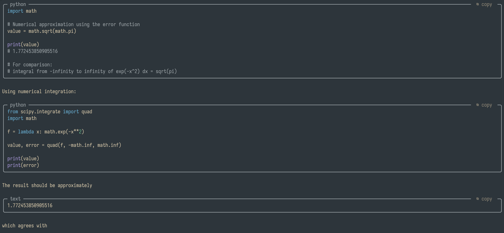

# pi-better-code-blocks



Code blocks in [Pi](https://github.com/earendil-works/pi)'s transcript are drawn as rounded,
org-modern-style boxes, with the declared language on the top border and a `⧉ copy` label that
copies the code when clicked.

```text
 ╭─ typescript ──────────────────────────────────────  ⧉ copy  ─╮
 │ export function greet(name: string): string {              │
 │   return `hello, ${name}`;                                 │
 │ }                                                          │
 ╰────────────────────────────────────────────────────────────╯
```

```
pi install npm:pi-better-code-blocks
```

- The language is whatever follows the opening fence (` ```ts `, ` ```python `, …). Fences without
  a language still get a box, just no language label.
- Clicking the label copies the code without the fences or indentation. It shows `✓ copied` for
  1.5s. Long lines wrap inside the box; the copied text is always the original source.
- Boxes are drawn everywhere Markdown is rendered in the TUI: assistant replies, thinking blocks,
  user messages and tool output. Narrow contexts (a code block in a deeply nested list, a very
  small terminal) fall back to Pi's normal fences.
- Only the fullscreen TUI delivers mouse clicks to components, so the label is hidden in the
  regular TUI mode. The boxes still render.
- Plain clicks elsewhere, drag-selection and copy-on-select work as before.

## How it works (hacky)

Pi has no public hook for how a Markdown code block is drawn
([earendil-works/pi#11276](https://github.com/earendil-works/pi/issues/11276)), so `patch.ts`
wraps the `Markdown` component's private `renderToken` and `render`, and adds `handleMouse`:

- `renderToken` replaces each `code` token with the box from `box.ts`.
- `render` strips a zero-width OSC marker from the label and records the label's row and column,
  so clicks map back to the right block after Pi has wrapped and padded the lines.
- `handleMouse` copies the block and re-renders the label for 1.5s.

Built against Pi 1.4.0. If a Pi update renames these internals, the boxes disappear and Pi keeps
working.

If [`pi-copy-button`](https://github.com/jonaslsaa/pi-copy-button) is installed too, it decorates
the same Markdown instances and takes over their mouse handling, so its labels win and the
`⧉ copy` label here stops responding. The extension warns about this at startup; remove
`pi-copy-button` to use this one.

## Development

```bash
npm install
npm run check
npm test
```

`box.ts` is pure and testable; `patch.ts` owns the Pi integration.
